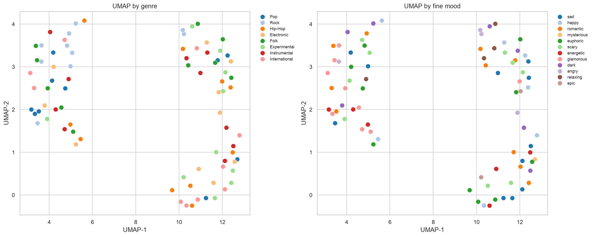

# Music Recommendation Semantics

Учебный проект: content-based рекомендации музыки на небольшом открытом датасете. Ноутбук выполнен end-to-end и сохранён с выводами и графиками.

**[Открыть ноутбук](music_recommendation_semantics.ipynb)**

## Что сделано

- 80 треков из FMA: 8 жанров по 10 треков, 30-секундные mp3.
- Признаки: DSP (39), CLAP-эмбеддинги (512), настроение (14/9 классов), 7 контекстов, 8 атмосфер, инструментальность, темп и энергия.
- EDA: распределения, корреляции, выбросы, ограничения.
- Similarity: CLAP, DSP, semantic profile и hybrid; оценка `P@1`/`P@5`.
- UMAP, примеры top-5 рекомендаций и выводы.

## Результаты

| Представление | Genre P@5 | Mood P@5 | Context P@5 |
|---|---:|---:|---:|
| Random | 0.114 | 0.091 | 0.208 |
| CLAP | 0.170 | 0.118 | 0.277 |
| DSP | 0.175 | 0.150 | 0.225 |
| Semantic | 0.145 | 0.167 | 0.653 |
| **Hybrid** | **0.195** | **0.180** | 0.450 |

Hybrid лучше случайного baseline по жанру и настроению. Глобальных кластеров нет: silhouette в CLAP-пространстве отрицательный, UMAP не показывает чистых жанровых островов.



## Запуск

1. Открыть `music_recommendation_semantics.ipynb` в Colab или Jupyter.
2. Выполнить все ячейки сверху вниз.
3. При первом запуске скачаются метаданные FMA, выбранные mp3 и модели Hugging Face.

Аудио и исходные метаданные FMA не хранятся в репозитории из-за размера. Они скачиваются автоматически. Для принудительной пересборки установить `FORCE_REBUILD = True` и `FORCE_EXTRACTION = True`.

## Данные

- FMA: https://freemusicarchive.org
- FMA dataset: https://github.com/mdeff/fma
- CLAP: https://huggingface.co/laion/larger_clap_music
- Mood model: https://huggingface.co/StanislavKo28/music_moods_classification

## Структура

```text
.
├── music_recommendation_semantics.ipynb
├── build_fma_dataset.py
├── extract_features.py
├── figures/
├── audio/              # создаётся при запуске
└── data/               # создаётся при запуске
```

## Ограничения

- 80 треков и 30-секундные фрагменты.
- Жанры FMA широкие, mood-модель даёт невысокую confidence.
- Контекст и атмосфера — rule-based baseline, а не ground truth.
- Метрики `P@5` косвенные: нет пользовательских оценок и A/B-тестов.
